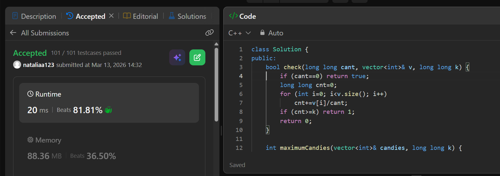

## Tema 1 SD - Pogar Denisa Natalia 151 

### Problem 1.1 - SumeSecv 
Am facut sume partiale.


```cpp
#include <iostream>
#include <vector>
using namespace std;
int n,q;
long long maxim;
vector<long long> v;
int main()
{
    cin>>n;
    v.push_back(0);
    for(int i=0;i<n;i++)
    {
        int x; cin>>x;
        v.push_back(x);
    }
    for(int i=1;i<=n;i++) v[i]+=v[i-1];
    cin>>q;
    for(int i=0;i<q;i++)
    {
        int l,r; cin>>l>>r;
        if(l>r) swap(l,r);
        if (i==0) maxim=v[r]-v[l-1];
        else
        {
            long long rasp=v[r]-v[l-1];
            if (rasp>maxim)  maxim=rasp; 
        }
    }
    cout<<maxim<<'\n';
    return 0;
} 
```
### Problem 1.2 -  Two Sum II

Pornim cu i din stanga, cu j din dreapta si cand gasim v[i]+v[j]==s ne oprim. 


```cpp
class Solution {
public:
    vector<int> twoSum(vector<int>& numbers, int target) {
        int i=0,j=numbers.size()-1;
        bool gasit=0;
        while(!gasit)
        {
            if (numbers[i]+numbers[j]<target) i++;
            else if (numbers[i]+numbers[j]>target) j--;
            else
            {
                vector<int> v;
                v.push_back(i+1);
                v.push_back(j+1);
                return v;
            }
        }
        return {}; ///nu mergea fara returnul asta
    }
};
```

###  Problem 1.3 - Search in Matrix II

Ne gandim la cautare ca la un drum in matrice. Datorita sortarii lor, mereu ce e "in jos" e mai mare, ce e "in sus" e mai mic, ce e "in drepata" e mai mare si ce e "in stanga" e mai mic. Asadar, putem porni ori din coltult drepta-sus ori din coltul stanga-jos. Am ales dreapta-sus. La fiecare pas avem de ales ori sa mergem in stanga (daca nuamrul caitat e mai mic decat cel curent) ori in dreapta (daca e mai mare). Astfel, nu ne vom intoarce niciodata si de aici complexitatea O(n). Ne oprim cand "iesim din matrice".


```cpp
    bool searchMatrix(vector<vector<int>>& matrix, int target) {
        int m=matrix.size();
        int n=matrix[0].size();
        int i=0;
        int j=n-1;
        while(i<m && j>=0)
        {
            if (target>matrix[i][j]) i++;
            else if (target<matrix[i][j]) j--;
            else return true;
        }
        return false;
    }
};
```
### Problem 1.4 - Statistici de Ordine
`in progress...`

###  Problem 2.1 - my_stl_vector + Problem 2.2
Am folosit implemenatrea vectorului dinamic pentru a rezolva problema 2. Pentru insert(x) am folosit push_back(x), iar pentru pop_random() am ales o pozitie random, am dat swap intre valoarea de pe pozitia p si ultimul element ca sa pot da pop_back() in O(1).

```cpp
#include <iostream>
#include <random>
using namespace std;

class Vector{
    int sizee, capacity;
    int *array_ads,*new_array;

    void my_resize()
    {
        if (capacity==0) capacity=2;
        capacity*=2;
        new_array=new int[capacity];

        for (int i=0;i<sizee;i++)
            new_array[i]=array_ads[i];

        delete[] array_ads;
        array_ads=new_array;
    }
public:
    Vector(int cp=2)
    {
        capacity=cp;
        array_ads=new int[cp];
        sizee=0;
    }
    ///constructor de copiere
    Vector(Vector &other)
    {
        sizee=other.sizee;
        capacity=other.capacity;

        array_ads=new int[capacity];
        for(int i=0;i<sizee;i++)
            array_ads[i]=other.array_ads[i];
    }
    ~Vector()
    {
        delete[] array_ads;
    }
    void my_push_back(int val)
    {
        if (sizee==capacity) my_resize();
        array_ads[sizee++]=val;
    }
    void pop_random()
    {
        if (sizee == 0)
        {
            cout << "Vectorul este gol!"<<'\n';
            return;
        }

        static std::random_device rd;
        static std::mt19937 gen(rd());
        std::uniform_int_distribution<int> distributie(0, sizee - 1);

        int pozitie_random = distributie(gen);
        cout<<array_ads[pozitie_random]<<' ';

        array_ads[pozitie_random]=array_ads[sizee-1];
        my_pop_back();
    }
    void my_pop_back()
    {
        if(sizee>0) sizee--;
    }

    int get_size()
    {
        return sizee;
    }
    int get_capacity()
    {
        return capacity;
    }

    ///am supraincarcta operatorul [] ca sa putem accesa elementele
    int &operator [](int i)
    {
        return *(array_ads+i);
    }

    Vector &operator =(Vector &other)
    {
        if (this==&other){ return *this;}

        ///setam noul size, si noua capacitate
        sizee=other.sizee;
        capacity=other.capacity;

        ///stergem vectorul vechi, alocam spatiu pentru cel nou
        delete[] array_ads;
        array_ads = new int[capacity];

        ///copiem elementele
        for(int i=0; i<sizee; i++)
            array_ads[i]=other.array_ads[i];
        return *this;

    }


};
int main() {
    Vector v1;
    for (int i = 1; i <= 5; i++) v1.my_push_back(i * 10);
    cout << "v1: Size=" << v1.get_size() << " Cap=" << v1.get_capacity() << "\n";
    v1[0] = 99;
    cout << "v1 modificat la index 0: " << v1[0] << "\n";
    Vector v2 = v1;
    v2.my_pop_back();
    cout << "v2 (copie) size dupa pop_back: " << v2.get_size() << "\n";
    Vector v3;
    v3 = v2;
    v3 = v3;
    cout << "Extrageri aleatoare din v3: ";
    while (v3.get_size() > 0) { v3.pop_random(); }
    cout << "\n";
    v3.pop_random();
    Vector v4(50);
    v4.my_push_back(7);

    return 0;
}

```


### Problem 3.1 - my_linked_list

Am facut o lista simplu inlantuita si i-am adaugat diferite functionalitati. 

```cpp
#include <iostream>
using namespace std;
class Node
{ public: int value;  Node *next;};
class List
{
    Node *head=nullptr, *tail=nullptr; int length=0;
public:
    ~List()
    {
        while(head!=nullptr)
            {
                Node *current=head;
                head=head->next;
                delete current;
            }
    }
    void push_back(int v)
    {
        Node *nod_nou=new Node();
        nod_nou->value=v; nod_nou->next=nullptr;

        ///daca lista era goala
        if (head==nullptr)
        {
            head=nod_nou;  tail=nod_nou;
        }
        else ///avem elemente
        {
            tail->next=nod_nou; ///legam nodurile
            tail=nod_nou;
        }
        length++;
    }
    void push_front(int v)
    {
        Node *nod_nou=new Node();
        nod_nou->value=v;
        nod_nou->next=head;///legam nodurile

        ///daca lista era goala
        if (head==nullptr)
        {
            head=nod_nou; tail=nod_nou;
        }
        else ///avem elemente
        { head=nod_nou; }
        length++;
    }
    void pop_end()
    {
        if(head==nullptr) return ;
        length--;
        if (head==tail)
        {
            delete tail;
            tail=nullptr; head=nullptr;
            return;
        }

        Node *current= head;
        while(current->next!=tail)  current=current->next;
        delete tail;
        current->next=nullptr;
        tail=current;

    }
    void pop_front()
    {
        if (head==nullptr) return ;

        length--;
        Node *current=head;
        head=current->next;
        delete current;

        if(head==nullptr) tail=nullptr; ///daca ramane lista goala
    }
   ///aici am facut o functie care returneaza efectiv nodul 
    Node *find_by_val(int v)
    {
        Node *current=head;

        while (current!=nullptr)
        {
            if(current->value==v)
                return current;
            current=current->next;
        }
        return nullptr;
    }
    ///aici returnez pozitia valorii cautate
    int find_pos_by_value(int v)
    {
        int poz=1;
        Node *current=head;

        while (current!=nullptr)
        {
            if(current->value==v)
                return poz;
            current=current->next;
            poz++;
        }
        return -1;
    }
    ///aici returnez valoarea pozitiei
    int find_by_index(int p)
    {
        if(p>length || p<=0) return -1;///it was suppposed to be an error

        Node *current=head;
        int cnt=1;
        while(cnt<p)
        {
            current=current->next;
            cnt++;
        }
        return current->value;
    }
   ///aici inseram o valoare pe pozitia p
    void insert_pos(int p, int v)
    {
        if (p<=0 || p>length+1) return;
        if(p==1) push_front(v); return;
        if (p==length+1) push_back(v); return;
        
        int cnt=1;
        Node *current=head;

        while(cnt<p-1)
        {
            current=current->next;
            cnt++;
        }

        Node *nod_nou=new Node();
        nod_nou->value=v;
        nod_nou->next=current->next;
        current->next=nod_nou;
        length++;
    }
    ///aici stergem valoarea de pe pozitia p
    void erase_pos(int p)
    {
        if (p<=0 || p>length) return;
        if(p==1) pop_front(); return; 
        if (p==length) pop_end(); return;

        int cnt=1;
        Node *current,*prev=head;

        while(cnt<p-1)
        {
            prev=prev->next;
            cnt++;
        }
        current=prev->next;
        prev->next=current->next;
        delete current;
        length--;
    }
    ///am facut si o functie de checkuit existenta
    bool found(int v)
    {
        if (head==nullptr) return 0;
        Node *current=head;

        while(current!=nullptr)
        {
            if (current->value==v)
            return 1;
            current=current->next;
        }

        return 0;
    }
   ///si afisat
    void print_list()
    {
        if (head==nullptr) return;

        Node *current=head;
        while(current!=nullptr)
        {
            cout<<current->value<<' ';
            current=current->next;
        }

    }

};
int main()
{
    List l;
    l.push_back(10); l.push_back(20); l.push_front(5);
    l.insert_pos(2, 7);
    cout << "Initial: "; l.print_list(); cout << "\n";
    cout << "Index 3: " << l.find_by_index(3) << "\n";
    cout << "Pozitie 20: " << l.find_pos_by_value(20) << "\n";
    cout << "Gasit 7? " << l.found(7) << "\n";
    cout << "Gasit 99? " << l.found(99) << "\n";
    l.pop_front();
    l.pop_end();
    cout << "Dupa pop capete: "; l.print_list(); cout << "\n";
    l.insert_pos(2, 15);
    l.erase_pos(2);
    cout << "Dupa erase mijloc: "; l.print_list(); cout << "\n";
    Node* adresa = l.find_by_val(7);
    if(adresa) cout << "Adresa nod 7: " << adresa << "\n";
    l.erase_pos(1);
    cout << "Final (ar trebui goala): "; l.print_list(); cout << "\n";
    for(int i = 1; i <= 5; i++) l.push_back(i * 10);
    cout << "Reumplere: "; l.print_list(); cout << "\n";

    return 0;
}
```

### Problem 3.2 - ciclu in lista 
Am folosit lista implementat anterior si am adaugat functionalitatile de lungime ciclu si pozitie de start pt ciclu. Spatiul suplimenatr e constant, caci folosim doar 2 pointeri suplimentari. Timpul e O(n), caci slow pointeul va face mereu max n pasi ca sa se intalneasca cu fast pointerul. 
```cpp
bool exista_ciclu()
    {
        Node *fp=head,*sp=head;
        if (sp==nullptr) return 0; ///lista goala
        while(true)
        {
            sp=sp->next;
            fp=fp->next;
            if(fp==nullptr) return 0;
            fp=fp->next;
            if(fp==nullptr) return 0;
            if (sp==fp) ///daca s-au intalnit pointerii
                return 1;
        }
    }
int poz_inceput_ciclu()
    {
        Node *fp=head,*sp=head;
        if (sp==nullptr) return 0; ///lista goala
        while(true)
        {
            sp=sp->next;
            fp=fp->next;
            if(fp==nullptr) return 0;
            fp=fp->next;
            if(fp==nullptr) return 0;
            if (sp==fp) ///daca s-au intalnit pointerii
                {
                    sp=head;
                    int cnt=1;
                    while(sp!=fp)
                    {
                        sp=sp->next; fp=fp->next; cnt++;
                    }
                    return cnt;
                }
        }
    }
    int lung_ciclu()
    {
        int p=poz_inceput_ciclu();
        if (p!= 0) return length-p+1;
        return 0;
    }
```

### Problem 4.1 - Candies

Am facut cautarea binara a raspunsului. De feicare data cand raspunsul era satisfacator, incercam cu o cantitate si mai mare, pana nu mai era unr aspuns viabil. Functia de check verifica efectiv daca putem da cantitatea C la >= k copii. 



```cpp
class Solution {
public:
    bool check(long long cant, vector<int>& v, long long k) {
        if (cant==0) return true;
        long long cnt=0;
        for (int i=0; i<v.size(); i++)
            cnt+=v[i]/cant;
        if (cnt>=k) return 1;
        return 0;
    }

    int maximumCandies(vector<int>& candies, long long k) {
        long long rasp=0;
        long long st=0;
        long long dr=0;
        for(int i=0; i<candies.size(); i++) if(candies[i]>dr) dr=candies[i];

        while (st<=dr) {
            long long mid=st+(dr-st)/2;
            if (check(mid, candies, k))
            {
                rasp=mid; st=mid+1;
            }
            else dr=mid-1;
        }
        return (int)rasp;
    }
};
```

### Problem 4.2 - Square root of n

Am gasit algoritmul lui Newton-Raphson care calculeaza radacina patrata in log(log n). Practic noi cautam "latura unui patrat" cu aria <= n si la fiecare pas facem media aritmetica dintre  x-ul ghicit si n/x, astfel apropiindu-ne de rezultat. Partea matematica spune ca la fiecare pas se dubleaza numarul de biti corecti. 
CPU -> aprox 6/10 iteratii pt numere de 64 biti => aprox 70 milioane de square roots/sec
GPU -> prob 15 miliarde/sec 

```cpp
#include <iostream>
using namespace std;
long long n;
double x,y;
int main() {
    long long n;
    cin>>n;
    if (n <= 1 ) { cout << n; return 0; }
    ///facem prima incercare
    x=n; 
    y=(x+n/x)/2.0;
    ///aici mergem pana cand urmatoarea aproximare este strict mai mica decat precedenta
    ///din cauza memoriei limitate, aproximarea nu va merge pana la infinit (avem numar fix de zecimale), iar x si y vor ajunge egale.
    while (y < x)
    { 
        x=y; y=(x+n/x)/2.0;
    }
    cout << (long long)x << "\n";
    return 0;
}
```

## Bonus 

### 1. LRU Cache
`in progress...`

### 2. Find Any Duplicate
`in progress...`

